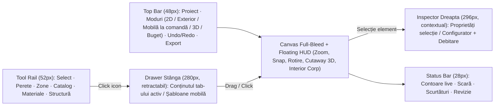

# Plan de Redesign UX/UI — RoomCraft Design Studio

> **Rol:** Senior Product & UX Designer  
> **Obiectiv:** Transformarea aplicației dintr-o pagină web înghesuită în coloane înguste într-un **studio de proiectare 2D/3D modern, aerisit, full-viewport** (la nivelul Figma / Homestyler / Planner 5D / Linear), păstrând 100% din funcționalitate, accesibilitate (WCAG AA) și compatibilitatea testelor existente.

---

## 1. Audit UX: De ce se simte înghesuit și „încărcat” acum

### Probleme structurale identificate în codul actual

| # | Problemă | Unde apare în cod | Impact UX |
|---|---|---|---|
| **1** | **Container îngust (`max-w-6xl`) în loc de full-viewport** | `src/features/editor-shell/SessionView.tsx` (`max-w-6xl`, `py-6`) | Pe monitoare 1440px–2560px, 35–50% din ecran sunt margini goale, în timp ce planul și inspectorul se înghesuie în 1152px. |
| **2** | **5 rânduri de bare stivuite deasupra canvas-ului** | `SessionView` header + `EditorClient` tabs + `PlanToolbar` + `RoomPalette` (2–3 rânduri) + `PlanHint` (3 linii de text) | **~320–400px** pe verticală sunt consumați de controale înainte să înceapă planul 2D/3D. Pe laptopuri (768–900px înălțime), canvas-ul rămâne sub 45% din ecran. |
| **3** | **Sidebar dreapta supraîncărcat (o singură coloană `w-80`)** | `PlanEditor.tsx` (`sidePanel` + `Notice` + `RoomList` + `PropertiesPanel` + `ElementList`) | Catalogul, Materialele, Proprietățile obiectului, Lista de camere, Formularele de coordonate și Lista de elemente sunt stivuite vertical într-o singură coloană de 320px → scroll interminabil și zgomot vizual. |
| **4** | **Lipsă de ierarhie vizuală și iconografie** | `PlanToolbar.tsx`, `RoomPalette.tsx`, `EditorClient.tsx`, `Button.tsx` | Toate butoanele sunt exclusiv text cu același stil (`border-stone-300`), cu greutate vizuală egală. Uneltele de bază (Select, Wall, Zoom) ocupă mult spațiu orizontal și se rup pe 2 rânduri. |
| **5** | **Cardul „Rezumatul proiectului” forțează scroll pe pagină** | `SessionView.tsx` (`workspace-summary` sub editor) | Un studio CAD nu ar trebui să aibă scroll vertical la nivel de pagină. Statisticile (camere, pereți, obiecte, revizie, salvare) aparțin unei **bare de status de 28px** jos. |
| **6** | **Texte de ajutor permanente (3 linii) deasupra planului** | `PlanHint.tsx` | Instrucțiunile lungi ocupă spațiu permanent chiar și pentru utilizatorii care știu deja să folosească editorul. |
| **7** | **Dashboard generic** | `Dashboard.tsx` (`float-right` pe `ThemeToggle`, carduri simple) | Prima impresie nu comunică un instrument de proiectare arhitecturală / amenajări interior + exterior. |

---

## 2. Arhitectura țintă: „Full-Viewport Studio”

### Principii de design (Senior UX)

1. **Canvas First (≥ 75% din viewport):** Planul 2D / Exterior / 3D este eroul absolut — ocupă tot spațiul disponibil, fără scroll pe pagină (`h-dvh overflow-hidden`).
2. **Progressive Disclosure (dezvăluire progresivă):** Afișăm doar ce contează acum. Când nu e selectat nimic, inspectorul e curat; când selectezi un perete, o cameră sau o hală, apar strict proprietățile relevante.
3. **Separarea clară a zonelor (3-Zone Studio Shell):**
   - **Stânga (Tool Rail + Drawer retractabil):** Creare & inserare (Unelte, Camere/Zone, Catalog, Materiale, Straturi).
   - **Centru (Canvas infinit + Floating HUD):** Suprafața de lucru + controale plutitoare discrete (Zoom pill, Grid/Snap, Contextual Hint).
   - **Dreapta (Inspector contextual):** Proprietățile elementului selectat (Dimensiuni, Parametri, Poziție, Finisaje).
4. **Densitate calibrată & Iconografie crisp:** Iconițe vectoriale SVG (16–18px, stroke `1.75px`) + tooltip-uri cu scurtătura de tastă (`W`, `V`, `R`, `Del`), reducând zgomotul textual cu ~60%.
5. **Un singur sistem vizual coerent (Light & Dark):** Suprafețe stratificate (Canvas `#f3f2ef` / `#141312`, Chrome `#ffffff` / `#1c1a18`, Floating HUD cu `backdrop-blur-md` și umbre subtile).

### Comparație vizuală (Înainte vs. După)

```text
ÎNAINTE (Pagina înghesuită, max-w-6xl, scroll pe pagină)
┌────────────────────────────────────────────────────────┐
│ ← Proiecte   Titlu   Salvat  [Tema] [Undo][Redo][...]  │
├────────────────────────────────────────────────────────┤
│ [Plan 2D] [Build Ext] [3D] [Buget]   [Mat] [Catalog]   │
├────────────────────────────────────────────────────────┤
│ [Select][Perete][-][+][Potrivește] Scară... [Șterge]   │
│ Adaugă cameră: [Living][Dorm][Buc][Baie][Hol][Birou]   │
│ [Cameră liberă][Living L][Cameră L]                    │
│ Trage o cameră din paletă pe plan. Trage nodurile...   │
├─────────────────────────────────┬──────────────────────┤
│                                 │ Catalog (scroll)     │
│        CANVAS MIC               │ ObjectPanel          │
│     (~45% din ecran)            │ RoomList             │
│                                 │ PropertiesPanel      │
│                                 │ ElementList          │
├─────────────────────────────────┴──────────────────────┤
│ Rezumatul proiectului (Camere / Pereți / Revizie...)   │
└────────────────────────────────────────────────────────┘

DUPĂ (Full-Viewport Studio, 100vw × 100dvh, zero scroll pe pagină)
┌─────────────────────────────────────────────────────────────────────────┐
│ ←  Titlu proiect ✎  ● Salvat │ [2D|Exterior|Mobilă|3D|Buget] │ ↶ ↷ ⬇ ◐ │  48px
├──┬───────────────┬──────────────────────────────────────┬───────────────┤
│  │               │                                      │               │
│↖ │  DRAWER       │                                      │  INSPECTOR    │
│▬ │  (retractabil)│            CANVAS FULL               │  CONTEXTUAL   │
│⊞ │  - Camere /   │   2D / Exterior / Configurator 3D /  │  (280–300px,  │
│🛋 │    Zone Ext   │              Scenă 3D                │   retractabil)│
│🎨│  - Catalog    │                                      │               │
│☰ │  - Materiale  │   [Hint 1 linie]      [ − 100% + ⊡ ] │  Proprietăți  │
│  │  - Structură  │                                      │  / Config.    │
├──┴───────────────┴──────────────────────────────────────┴───────────────┤
│ 2 camere · 7 pereți · 4 obiecte · Scară: 100px ≈ 1m · Scurtături: ON    │  28px
└─────────────────────────────────────────────────────────────────────────┘
```

### Fluxul de interacțiune al studioului



---

## 3. Detalierea fiecărei zone din Studio

### 3.1. Top Studio Bar (`48px` fix, full-width)
- **Stânga:**
  - Buton discret `←` (înapoi la proiecte)
  - Numele proiectului editabil **inline** (sau click pe iconița `✎` care deschide `NameDialog` — elimină butonul mare „Redenumește”)
  - Indicator de salvare compact tip pill: punct colorat + text scurt (`Salvat` / `Se salvează…` / `Nesalvat`), cu tooltip pentru ora ultimei salvări.
- **Centru (Segmented Control):**
  - Un **segmented control** elegant cu fundal `bg-stone-100` și pastilă activă albă cu umbră fină:
    - `Plan 2D` | `Build Exterior` | `Mobilă la comandă` | `3D` | `Buget`
  - Păstrează `role="tablist"` și navigarea cu săgeți / Home / End (`tests/ui/a11y.test.tsx`).
- **Dreapta:**
  - Grup compact `Undo` (`↶`) + `Redo` (`↷`) cu iconițe și tooltip cu eticheta acțiunii.
  - Buton compact `Export` (icon + text pe desktop) pentru copia de siguranță.
  - `ThemeToggle` icon-only (soare/lună).

### 3.2. Left Tool Rail (`52px` fix) + Left Drawer (`280–300px`, retractabil)
Înlocuiește `PlanToolbar`, `RoomPalette` și butoanele plutitoare `Catalog` / `Materiale` cu un **Tool Rail** vertical curat (standard Figma / AutoCAD Web):

- **Sus (Unelte directe pe canvas — nu deschid drawer):**
  1. **Selectează (`V`)** — cursor
  2. **Perete nou (`W`)** — creion/linie perete
- **Separator fin**
- **Mijloc (Panouri retractabile — deschid/închid Left Drawer):**
  3. **Camere / Zone Exterioare** — afișează carduri vizuale 2-coloane (mini-schiță dreptunghi / L + dimensiuni) pentru camere (în *Plan 2D*) sau zone exterioare (în *Build Exterior*: Curte, Fundație, Parcare, Garaj, Hală, Terasă).
  4. **Catalog obiecte** — căutare sticky sus, chip-uri de categorii scrollabile orizontal (sau dropdown de categorie ca să nu ocupe 4 rânduri!), grid 2-coloane cu preview SVG mai mare și badge de dimensiuni. În *Build Exterior*, filtrat implicit pe exterior.
  5. **Materiale & Finisaje** — swatch-uri pătrate clare, filtrare după suprafață + categorie, previzualizare rapidă a materialului aplicat.
  6. **Structură proiect (Outliner)** — reunește `RoomList` și `ElementList` într-un arbore curat (Camere · Pereți · Obiecte), cu click pentru focus și hover highlight.
- **Jos (Utilitare):**
  - Buton **Colapsează / Extinde panoul** și **Ajutor / Scurtături** (popover compact cu lista de taste: `V`, `W`, `R`, `Del`, `Ctrl+Z`, `Ctrl+D`, `0`).

> **Câștig imediat:** Elimină complet cele 3–4 rânduri de deasupra planului! Pe un laptop de 900px înălțime, canvas-ul crește de la ~420px la **~780px** (+85% spațiu de lucru!).

### 3.3. Canvas Full-Bleed + Floating HUD (2D / Exterior / 3D)
- **Canvas-ul 2D:**
  - Ocupă 100% din zona centrală, fără border gros inutil, cu fundal subtil de plansă tehnică (grilă fină adaptată la zoom).
  - **Floating Bottom-Center Pill (Zoom & View):** `[ − ]  100%  [ + ]  |  [ Potrivește ]` pe suprafață translucidă (`bg-surface/90 backdrop-blur-md shadow-md border border-stone-200/80 rounded-full`).
  - **Floating Contextual Action Bar (Top-Center, doar când e activ un mod):**
    - În timpul plasării unei camere: pastilă compactă `Plasează „Living” · [↻ Rotește (R)] · [Anulează (Esc)]`.
    - La selecție multiplă: pastilă compactă `3 obiecte selectate · [Duplică] · [Șterge]`.
  - **Floating Bottom-Left Micro-Hint:** O singură linie discretă, dismissible sau auto-adaptată la unealta activă (păstrând `id="plan-hint"` pentru `aria-describedby`).
- **Vizualizarea 3D (`Viewer3D.tsx`):**
  - Controalele 3D (`Resetează`, `De sus`, `Pereți tăiați`, `Centrează pe selecție`) devin o **bară plutitoare compactă** (top-center sau bottom-center) peste viewport-ul 3D full-bleed!
  - Hint-ul de mouse (`Drag: rotește · Scroll: zoom · Right-drag: pan`) trece într-un micro-badge discret în colțul stânga-jos.

### 3.4. Right Contextual Inspector (`296px`, retractabil)
- **Se adaptează inteligent la selecție:**
  - **Obiect selectat** → `ObjectPanel` organizat în secțiuni colapsabile curate: *Dimensiuni (L × A × H)*, *Poziție & Rotație* (cu butoane rapide `-90° / +90°`), *Parametri rețetă*, *Culoare & Finisaje* (link rapid către Materiale), *Acțiuni* (Duplică, Șterge).
  - **Cameră / Perete / Gol / Nod selectat** → `PropertiesPanel` curat, cu input-uri aliniate în grid 2-coloane, unități inline (`mm` în interiorul input-ului în dreapta, nu ca sub-label separat care mărește înălțimea!).
  - **Nimic selectat** → Nu mai afișează simultan 2 formulare grele de coordonate + 2 liste! Afișează un **Empty State** aerisit cu:
    - Setările rapide ale proiectului (Unitate `mm/cm/m`, Pas grilă, Înălțime implicită pereți).
    - Acordeon colapsat: *„Adăugare precisă din coordonate”* (pentru accesibilitate / tastatură fără mouse — păstrând formularele 100% funcționale pentru `AddPanel` și teste).
- Pe ecrane mai mici (`< 1280px`), inspectorul se poate ascunde cu un buton discret din colțul dreapta-sus ca să lase tot ecranul pentru canvas.

### 3.5. Bottom Status Bar (`28px` fix)
Înlocuiește cardul mare `workspace-summary` din `SessionView.tsx` cu o bară subțire, permanentă, de tip CAD:
- **Stânga:** `2 camere · 7 pereți · 4 obiecte` (păstrând `data-testid="count-rooms"`, `count-walls`, `count-objects`).
- **Centru:** `Scară: 100 px ≈ 1,0 m` · toggle discret `Scurtături: ON/OFF`.
- **Dreapta:** `Rev. 4 · Istoric: 3 · Editare · v1`.

### 3.6. Modulul „Mobilă la comandă” (Configurator parametric + Listă de debitare)

Un studio dedicat proiectării pieselor de mobilier la milimetru (PAL melaminat 18mm / MDF / lemn / feronerie), integrat direct în același proiect: orice piesă creată aici poate fi plasată instant în **Plan 2D** și văzută în **Vizualizare 3D**, iar costurile intră automat în **Buget**.

#### Structura ecranului „Mobilă la comandă”
```text
┌─────────────────────────────────────────────────────────────────────────┐
│ ←  Titlu proiect   │ [2D|Exterior|● Mobilă la comandă|3D|Buget] │ ↶ ↷   │
├──────────────────┬──────────────────────────────────┬───────────────────┤
│ ȘABLOANE & PIESE │                                  │ CONFIGURATOR      │
│                  │      PREVIEW 3D IZOLAT           │ [Structură|Mat|€] │
│ + Nou la comandă │    (Orbit · Față · Lateral)      │                   │
│  • Dressing      │                                  │ Lățime:  [1800]mm │
│  • Corp bucăt.   │       ┌──────────────┐           │ Adâncime:[ 600]mm │
│  • Bibliotecă    │       │  │   │   │   │           │ Înălțime:[2400]mm │
│  • Comodă / TV   │       │  ├───┼───┤   │           │ Coloane: [ 3 ]    │
│  • Birou / Ins.  │       │  │===│===│   │           │ Polițe:  [ 5 ]    │
│                  │       └──┴───┴───┴───┘           │ Sertare: [ 3 ]    │
│ ──────────────── │                                  │ Uși: [Culisante▾] │
│ PIESE ÎN PROIECT │  [👁 Fără uși] [📏 Cote] [↻ 3D]  │ Soclu: [100 mm]   │
│  • Dressing 1    │                                  │ ───────────────── │
│  • Corp bază 60  │                                  │ [Plasează în plan]│
└──────────────────┴──────────────────────────────────┴───────────────────┘
```

#### Funcționalități cheie ale configuratorului
1. **Șabloane parametrice de mobilă la comandă (`category: 'mobila-comanda'`):**
   - **Dressing / Dulap la comandă** (`600–4000 × 400–800 × 1800–2800 mm`): număr coloane (`1–6`), tip uși (`batante`, `culisante`, `deschis`), polițe pe coloană, sertare interioare (`0–8`), bară haine, soclu (`plinth` / `legs`), grosime placă (`18mm` / `36mm`).
   - **Corp de bucătărie la comandă** (`300–1600 × 300–800 × 400–2400 mm`): tip (`bază`, `suspendat`, `coloană cuptor/frigider`), fronturi (`uși`, `sertare`, `combinat`, `deschis`), mânere (`clasice`, `fără / push-to-open`), blat + suprapunere, decupaj chiuvetă.
   - **Bibliotecă / Perete media la comandă** (`800–4200 × 250–600 × 800–2800 mm`): coloane × rânduri, nișă TV opțională, uși/sertare pe zona de jos, spate PFL/PAL.
   - **Birou / Insulă / Comodă la comandă** (`800–3000 × 450–1200 × 650–1050 mm`): sertare stânga/dreapta/ambele, spațiu liber, blat gros, cadru metalic sau panouri PAL.
2. **Vizualizare 3D izolată a piesei:**
   - **Toggle „Vezi interiorul (fără uși)”** — ascunde temporar fronturile ca să verifici compartimentarea (polițe, sertare, bare de haine).
   - **Vederi rapide:** Perspectivă, Față (elevație), Lateral, De sus + cote globale `L × A × H` în mm.
3. **Finisaje pe zone (sloturi existente `body | front | top | metal`):**
   - Aplici separat materialul de **Carcasă (PAL)**, **Fronturi (MDF/PAL)**, **Blat** și **Feronerie/Cadru metalic** din catalogul de materiale (cu extinderea paletei de decoruri PAL/MDF: Stejar Sonoma, Cashmere, Antracit, Nuc, Alb mat/lucios).
4. **Fișă de debitare (Cut List) & Estimare automată de cost:**
   - Calcul pur în `domain/` (fără schimbare de schemă!) pe baza dimensiunilor și parametrilor corpului:
     - **Lista panourilor de debitat** (ex: `2× Lateral 2400×600 mm`, `2× Capac/Fund 1764×600 mm`, `5× Poliță 576×560 mm`, `3× Front ușă 596×2296 mm`, `Spate PFL`).
     - **Total suprafață plăci (m²)** (cu factor de pierdere/croire), **metri liniari cant ABS (ml)** și **feronerie** (balamale, glisiere sertare, mânere, picioare reglabile).
     - **Export CSV** direct pentru atelierul de debitare + preț estimativ sincronizat cu **Bugetul** proiectului.
5. **Integrare bidirecțională cu Plan 2D / 3D:**
   - Buton **„Plasează în plan”** (adaugă obiectul în documentul proiectului, cu `FinishAssignment`-urile lui pe sloturi).
   - Selectând un obiect de tip `mobila-comanda` din Plan 2D / 3D, apare în Inspector butonul **„Deschide în Configurator”** pentru editare în detaliu.
   - **Zero schimbări de schemă (`CURRENT_VERSION = 1`):** totul se salvează nativ în `objects` + `catalogSnapshot` + `finishAssignments`.

### 3.7. Redesign Dashboard (`Dashboard.tsx` & `ProjectCard.tsx`) & Buget (`BudgetPanel.tsx`)
- **Dashboard:**
  - Header curat tip flex (fără `float-right`), cu CTA principal clar **„+ Proiect nou”** și buton secundar **„Importă .roomcraft.json”**.
  - Grid de carduri de proiecte cu **mini-previzualizare vizuală** (sau banner de stare cu contoare: camere, obiecte, exterior/interior, dată actualizare), hover elevation subtilă și meniu de acțiuni (`Deschide`, `Redenumește`, `Copie`, `Șterge`) mai aerisit.
  - Dropzone de import integrat elegant în pagină (apare clar la drag-over).
- **Buget (`BudgetPanel.tsx`):**
  - **KPI Summary Strip** sus (3 carduri curate: *Subtotal*, *Rezervă (5%)*, *Total estimat cu TVA*) + acțiuni de export (`CSV`, `Excel .xlsx`) aliniate în dreapta.
  - Tabel cu rânduri mai respirabile, sticky header, badge-uri colorate pe categorii (Mobilier, Finisaje, Exterior, Manoperă) și editare inline clar evidențiată.

---

## 4. Sistem de Design (Tokens & Vizual)

### Paletă & Suprafețe (`src/app/globals.css`)
Păstrăm tema actuală `stone` + `teal` (e caldă, arhitecturală și plăcută ochiului), dar rafinăm contrastul dintre straturi:

| Token / Rol | Light Mode | Dark Mode | Utilizare |
|---|---|---|---|
| `--color-canvas` | `#f4f3ef` | `#121110` | Fundalul planșei 2D / 3D |
| `--color-surface` | `#ffffff` | `#1c1a18` | Top bar, Rail, Drawer, Inspector |
| `--color-surface-subtle` | `#faf9f7` | `#242220` | Segmented controls, input-uri, carduri secundare |
| `--color-border` | `stone-200` (`#e7e5e4`) | `stone-800` | Separatoare fine `1px` |
| `--color-primary` | Teal `#0f766e` | Teal luminos | Unealtă activă, selecție, CTA principal |
| `--color-exterior-accent` | Emerald/Sage `#2f6f4e` | Emerald luminos | Accent subtil pentru tab-ul & badge-urile *Build Exterior* |
| `--color-custom-accent` | Amber/Warm Wood `#9a5b25` | Amber cald | Accent subtil pentru tab-ul & badge-urile *Mobilă la comandă* |

### Tipografie & Spațiere
- **Font UI:** `Inter` / `Geist` (sans-serif curat) + `tabular-nums` pe **toate** dimensiunile, coordonatele, ariile și prețurile (cifrele nu mai „dansează” la editare sau drag!).
- **Scară compactă pentru Studio:**
  - Titlu panou: `13px` semibold (`text-[13px] font-semibold tracking-tight`)
  - Label câmp: `11px` medium uppercase/muted (`text-[11px] font-medium text-stone-500`)
  - Valori & input-uri: `13px` cu înălțime `32px–36px` (`h-9`, respectând țintele de accesibilitate unde e necesar).
- **Iconițe:** Set intern minimal de iconițe SVG curate (`src/ui/icons.tsx` — zero dependențe externe, 100% offline, respectă `license-gate.test.ts` și `depcruise`).

---

## 5. Constrângeri tehnice de respectat (Zero regresii)

Pentru ca redesign-ul să nu rupă arhitectura excelentă existentă:
1. **Reguli `depcruise` (`.dependency-cruiser.cjs`):**
   - `src/ui/` rămâne pur (fără importuri din `state/`, `features/`, `app/`).
   - Modulele din `src/features/` NU se importă între ele; compoziția panourilor rămâne în `src/app/editor/EditorClient.tsx`.
   - Three.js rămâne strict în `src/features/viewer-3d/`.
2. **Contracte `data-testid` & Accesibilitate (`tests/ui/*.test.tsx`, `e2e/*.spec.ts`):**
   - Păstrăm toate `data-testid`-urile existente (`mode-2d`, `mode-exterior`, `mode-3d`, `mode-budget`, `catalog-toggle`, `materials-toggle`, `plan-toolbar`, `room-palette`, `plan-hint`, `plan-box`, `properties`, `workspace-summary`, `count-rooms`, etc.).
   - Păstrăm modelul ARIA complet: `role="tablist"`, roving `tabindex`, `aria-live="polite"` pe `selection-announcer`, `forced-colors` și `prefers-reduced-motion`.
   - Păstrăm formularele fără mouse (`AddPanel`) accesibile în inspector (fie vizibile direct, fie printr-un toggle clar).
3. **Zero modificări de schemă:** `CURRENT_VERSION = 1` și `tests/domain/schema-shape.test.ts` rămân neatinse.

---

## 6. Plan de implementare pe etape

| Fază | Scop | Fișiere principale | Criteriu de „Gata” |
|---|---|---|---|
| **Faza 1 — Studio Shell Full-Viewport & Status Bar** | Eliminarea `max-w-6xl` din editor, Top Bar compact de 48px, Segmented Control pentru moduri, mutarea `workspace-summary` în Status Bar de 28px jos, zero scroll pe pagină. | `src/app/globals.css`, `src/ui/icons.tsx`, `src/features/editor-shell/SessionView.tsx`, `src/app/editor/EditorClient.tsx` | Canvas-ul ocupă ≥75% din înălțimea viewport-ului; `a11y.test.tsx` și `editor.test.tsx` verzi. |
| **Faza 2 — Left Tool Rail & Drawer Retractabil** | Mutarea uneltelor (`Select`, `Perete`), a paletei de camere/zone exterioare, a catalogului, a materialelor și a structurii (`RoomList`/`ElementList`) în rail-ul din stânga + drawer retractabil. | `src/features/plan-editor/PlanEditor.tsx`, `PlanToolbar.tsx`, `RoomPalette.tsx`, `src/features/catalog/CatalogBrowser.tsx`, `src/features/materials/MaterialsPanel.tsx` | Dispar complet cele 3 rânduri de bare de deasupra planului; comutarea rapidă între Camere / Catalog / Materiale. |
| **Faza 3 — Floating Canvas HUD (2D & 3D)** | Zoom pill plutitor jos-centru, micro-hint contextual jos-stânga, bară plutitoare de rotire/selecție multiplă, bară 3D plutitoare peste viewport-ul 3D. | `src/features/plan-editor/PlanEditor.tsx`, `PlanHint.tsx`, `src/features/viewer-3d/Viewer3D.tsx` | Planul 2D și scena 3D arată ca un studio CAD modern, aerisit. |
| **Faza 4 — Right Contextual Inspector** | Regruparea `PropertiesPanel` și `ObjectPanel` cu secțiuni curate, input-uri cu unități inline, `tabular-nums`, empty state curat + acordeon pentru coordonate, buton de colapsare. | `src/features/plan-editor/PropertiesPanel.tsx`, `src/features/catalog/ObjectPanel.tsx`, `src/ui/fields.tsx` | Zero scroll inutil în dreapta; editare mult mai rapidă a dimensiunilor și parametrilor. |
| **Faza 5 — Modul „Mobilă la comandă” (Configurator + Debitare)** | Rețete parametrice de mobilier la comandă (Dressing, Corp bucătărie, Bibliotecă/Media, Birou/Insulă), calcul pur de listă de debitare (panouri mm, m² PAL/MDF, ml cant, feronerie) + export CSV, tab dedicat în Studio cu preview 3D izolat (inclusiv „fără uși”), selecție materiale pe sloturi și „Plasează în plan”. | `src/catalog/recipes.ts`, `src/catalog/items.ts`, `src/domain/custom-furniture/` (sau `src/domain/quantities/`), `src/features/custom-furniture/`, `src/app/editor/EditorClient.tsx` | Poți configura o piesă la mm, îi vezi interiorul în 3D, îi exporți lista de debitare și o plasezi direct în planul 2D/3D și în Buget (`schemaVersion = 1` intact). |
| **Faza 6 — Polish Dashboard & Buget** | Header modern pe Dashboard, carduri de proiecte mai clare, KPI strip + tabel aerisit în Buget, verificare completă Light/Dark & responsive (tabletă/laptop/ultrawide). | `src/features/projects/Dashboard.tsx`, `ProjectCard.tsx`, `src/features/budget/BudgetPanel.tsx` | Toată aplicația are un limbaj vizual unitar; `pnpm lint`, `typecheck`, `depcruise`, `test` și `build` verzi. |

---

## 7. Cum pornim?

Recomand să implementăm în această ordine:
1. **Faza 1 + Faza 2** (impact vizual imediat: Full-Viewport Studio + Left Tool Rail + Status Bar).
2. **Faza 3 + Faza 4** (Floating HUD 2D/3D + Right Contextual Inspector).
3. **Faza 5** (Secțiunea completă **Mobilă la comandă** cu configurator 3D izolat + listă de debitare + plasare în plan).
4. **Faza 6** (Polish Dashboard & Buget + verificare completă).
